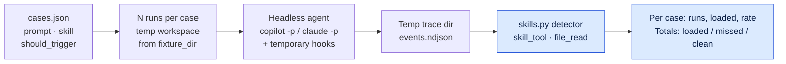

# Skill trigger eval: `agent-strace skills eval` (experimental)

[`agent-strace skills`](skills.md) reports which skills loaded in sessions that
were already recorded. It cannot say whether a skill *should* have loaded.
`skills eval` tests that directly. You write tasks that should load a skill and
near-miss tasks that should not, run each one through a headless agent several
times, and count the runs in which the model loaded the skill.



```bash
agent-strace skills eval cases.json --agent copilot              # 3 runs per case
agent-strace skills eval cases.json --agent claude --runs 5 --case draft-notes
agent-strace skills eval cases.json --agent copilot --save-traces runs/
agent-strace skills eval cases.json --from-traces runs/           # offline, no agent
```

Flags: [commands.md](commands.md#skills-eval).

## Prior art

- Anthropic's [skill-creator](https://github.com/anthropics/skills/tree/main/skills/skill-creator)
  trigger evals. Each query has `should_trigger: true|false`, and
  `scripts/run_eval.py` runs `claude -p` several times per query and checks
  whether the skill was invoked. The cases format here follows it.
- Vercel, [AGENTS.md outperforms skills in our agent evals](https://vercel.com/blog/agents-md-outperforms-skills-in-our-agent-evals).
  An available skill was never invoked in 56% of their eval cases. Explicit
  instructions to use it raised that, and results were sensitive to wording.

Differences from skill-creator: there is no trigger threshold and no pass/fail
per query, any agent with hooks can be used, and detection reads the
agent-strace trace instead of the agent's stream output.

## Cases file

JSON only (the package has no YAML parser and no runtime dependencies). Use a
list of cases, or `{"cases": [...]}`.

| Key | Required | Meaning |
|---|---|---|
| `id` | yes | Unique id: letters, digits, `.`, `_`, `-` |
| `skill` | yes | Skill name to watch for (`plugin:name` also matches `name`) |
| `prompt` | yes | The task, sent verbatim |
| `should_trigger` | yes | `true` for tasks that should load the skill, `false` for near misses |
| `fixture_dir` | no | Directory copied into each run's workspace. Relative to the cases file |
| `runs` | no | Runs for this case. Default is `--runs`, else 3 |
| `note` | no | Free text, copied to the report |

[examples/skills-eval/](../examples/skills-eval/) has a complete example: a
`release-notes` skill in `fixture/.claude/skills/`, a small `CHANGELOG.md`, and
three cases of each kind.

```json
[
  {"id": "draft-notes", "skill": "release-notes", "should_trigger": true,
   "prompt": "Draft the release notes for the next version.", "fixture_dir": "fixture"},
  {"id": "count-fixes", "skill": "release-notes", "should_trigger": false,
   "prompt": "How many bug fixes are listed for version 1.2.0 in CHANGELOG.md?",
   "fixture_dir": "fixture"}
]
```

Write prompts the way a user would. A prompt that names the skill (`/release-notes`
or `$release-notes`) tests the user invoking it, not the model choosing it. The
report flags such cases as `explicit_invocation`, and prompt-driven loads count
as `user_invoked`, not as triggers. Good negatives are near misses: tasks in the
same files or domain that the skill should not handle.

## Runs

Each run gets a fresh temporary directory with:

- `workspace/`: a copy of `fixture_dir`, or empty. The agent runs here.
- `traces/`: `AGENT_TRACE_DIR` for the run. Hooks write here.
- `hooks-plugin/` and `claude-settings.json`: temporary hook configs, the same
  hooks `agent-strace setup` writes, run with the current interpreter.

Runs are sequential. Progress goes to stderr. The directory is deleted after
the run unless `--keep-workspaces` is set.

### Agent presets

| Preset | Command |
|---|---|
| `copilot` | `copilot -p {prompt} --add-dir {workspace} --plugin-dir {hooks_plugin_dir} --no-ask-user -s` |
| `claude` | `claude -p {prompt} --settings {claude_settings}` |

`--agent-cmd TEMPLATE` runs any other command. Placeholders: `{prompt}`
(required), `{workspace}`, `{trace_dir}`, `{hooks_plugin_dir}`,
`{claude_settings}`. The
template is split with shell rules once, then placeholders are substituted per
argument. Values are never re-split and no shell runs, so a prompt with quotes
or `;` is passed as one argument. The agent must fire agent-strace hooks into
`AGENT_TRACE_DIR`. Use `{hooks_plugin_dir}` or `{claude_settings}`, or your own
hook setup.

### Safety

- **No preset approves every tool.** `--allow-all-tools`, `--allow-all`,
  `--yolo`, `--dangerously-skip-permissions`, and
  `--permission-mode bypassPermissions` are never added. If your template
  contains one, the eval runs it and prints a warning.
- Without approval, a headless agent can still call the skill tool and use
  read-only tools in the workspace. Tools that would need approval are not
  approved. Depending on the agent, it carries on without them or stops. The
  skill load is recorded either way, and a non-zero exit with no load is
  `unscored`. To allow specific tools, add them yourself with `--agent-cmd`,
  for example `--allow-tool 'shell(git:*)'` (Copilot) or `--allowedTools Read`
  (Claude).
- The run's environment drops `COPILOT_ALLOW_ALL`, `AGENT_STRACE_ENDPOINT`,
  `AGENT_STRACE_WORKSPACE`, and per-provider session overrides, so events stay
  in the run's trace dir. `CLAUDECODE` is dropped so `claude -p` can start
  inside Claude Code.
- Each run has a timeout (`--timeout`, default 300s). On timeout the process
  group gets SIGTERM, then SIGKILL after 5s.
- The agent runs with your credentials and your user-level config. Use a
  fixture you would be happy for it to modify.

Live runs are tested on macOS and Linux.

## What counts

A run is **loaded** when the trace shows the model loading the skill: a skill
tool call (`skill`, `Skill`, `activate_skill`) or a read of its `SKILL.md`.
Detection is `agent_trace.skills`. There is no second detector, so the eval and
`agent-strace skills` agree on what a load is.

| Status | Meaning |
|---|---|
| `loaded` | The model loaded the skill in any session of the run, including subagents. Counted even if the agent later failed |
| `not_loaded` | The agent exited 0, events were recorded, and no load was found |
| `unscored` | No load, and the run cannot be scored: error, timeout, non-zero exit, or no events |

`trigger_rate` is `loaded / (loaded + not_loaded)`. Unscored runs are reported
but kept out of the rate, so a broken agent setup does not look like a miss.

Totals split by expectation:

- **should trigger**: `loaded` and `missed` (= `not_loaded`) runs
- **should not trigger**: `loaded` (false trigger) and `clean` runs

There is no composite score or threshold. Two runs out of three is a count, not
a grade.

```
Skill trigger eval (experimental)
  agent: copilot GitHub Copilot CLI 1.0.94-3   default runs: 1   timeout: 240s

  CASE         SKILL          EXPECT      RUNS  LOADED  RATE
  draft-notes  release-notes  trigger        1       1  100% (1/1)
  count-fixes  release-notes  no trigger     1       0  0% (0/1)

  should trigger:     1 runs, 1 loaded, 0 missed, 0 unscored
  should not trigger: 1 runs, 0 loaded, 1 clean, 0 unscored
```

### Exit codes

| Code | When |
|---|---|
| `0` | Report printed. Misses and false triggers do not fail by default |
| `1` | A gate failed: `--fail-on-miss` (a should-trigger case missed, or has unscored or zero runs) or `--fail-on-false-trigger` (a should-not-trigger case loaded, or has unscored or zero runs) |
| `2` | Bad input: cases file, template, option, or missing agent program |

## Offline scoring: `--from-traces`

`--from-traces DIR` scores recorded runs without calling an agent. CI uses
this, and `--save-traces DIR` writes the same layout from a live run:

```
DIR/
  <case-id>/
    run-1/
      run.json            optional: exit_code, timed_out, duration_s, error, agent, agent_version
      <session-id>/       agent-strace session dirs (events.ndjson, meta.json)
    run-2/
```

A case directory that directly holds session dirs counts as one run. Without
`run.json`, a run is scored from its events alone. Directories that match no
case produce a warning. `--save-traces` output contains prompts, tool arguments,
and tool output from the run. Review it before sharing.

## JSON output

`--format json` prints `schema_version` (1), `experimental: true`, `mode`
(`live` or `from_traces`), `cases_file`, `agent` (live: name, command,
version, timeout), `totals`, `warnings`, `caveats`, and `cases`. Each case has
`id`, `skill`, `should_trigger`, `prompt`, `note`, `explicit_invocation`,
`runs`, `scored`, `loaded`, `not_loaded`, `unscored`, `trigger_rate` (null when
nothing was scored), `user_invoked_runs`, and `run_results`. Each run result has
`run`, `status`, `unscored_reason`, `exit_code`, `timed_out`, `duration_s`,
`error`, `loaded`, `methods`, `user_invoked`, `sessions`,
`sessions_without_meta`, `sessions_without_session_start`, `load_sessions`, and
`other_skills_loaded`.

## What it measures, and what it doesn't

It measures whether, for these prompts, this agent, this model and version, and
this fixture, the model loaded the skill, and how often over N runs.

It does not measure:

- whether the skill was followed after loading, or helped (see
  [skills.md](skills.md) for follow signals);
- skills injected into context without a tool call or file read;
- other prompts. The prompt wording is the test, so a rephrased task can
  trigger differently;
- other agents, models, or versions. Record `agent_version` with your results.

## Caveats

- **Non-deterministic.** The same prompt can load the skill in one run and not
  the next. Read 2/3 as "sometimes", not 67%.
- **Small N.** Three runs show direction. Use more runs, or more cases, before
  you compare two skill descriptions.
- **Depends on the agent, model, and version,** and on every other skill,
  plugin, and instruction file the agent can see. User-level skills and plugins
  load in eval runs too, and can compete with the skill under test.
  `other_skills_loaded` lists them.
- **Duplicate hooks.** If the agent-strace Copilot plugin is installed for your
  user, its hooks also fire into the run's trace dir. Events can be recorded
  twice. A run is still loaded or not, so counts are unaffected.
- **Subagents.** Copilot CLI subagents fire hooks under their own session id
  without a session start. agent-strace records them as their own sessions,
  and the eval scores every session in a run, so a load inside a subagent
  counts. The report notes runs whose only load was in such a session.
