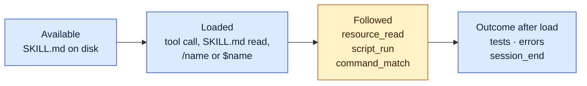
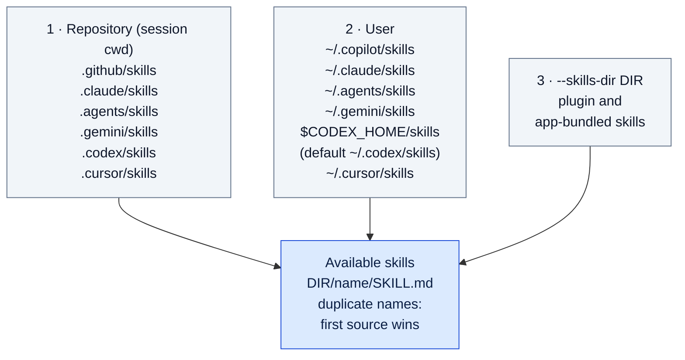
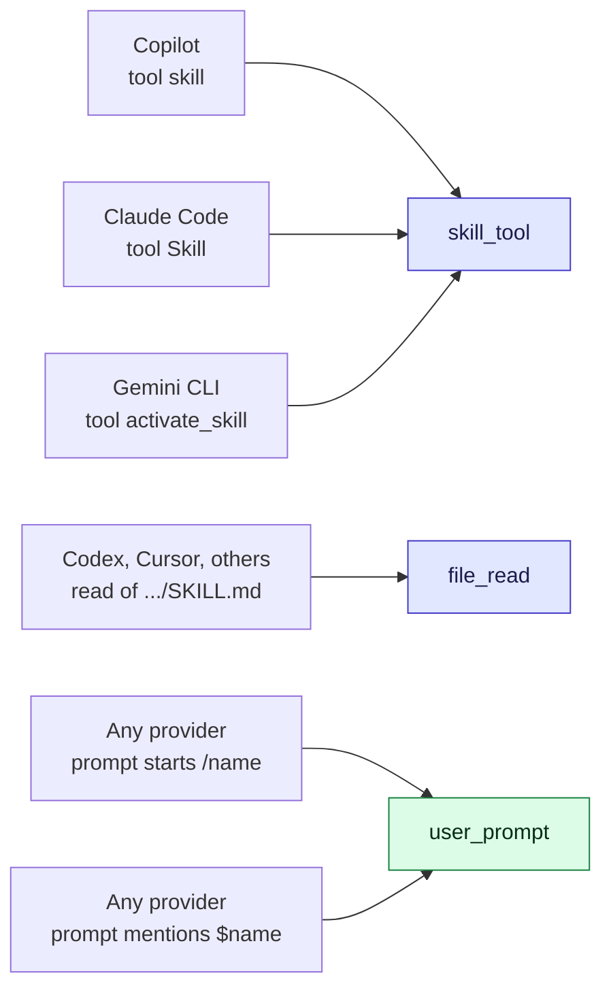
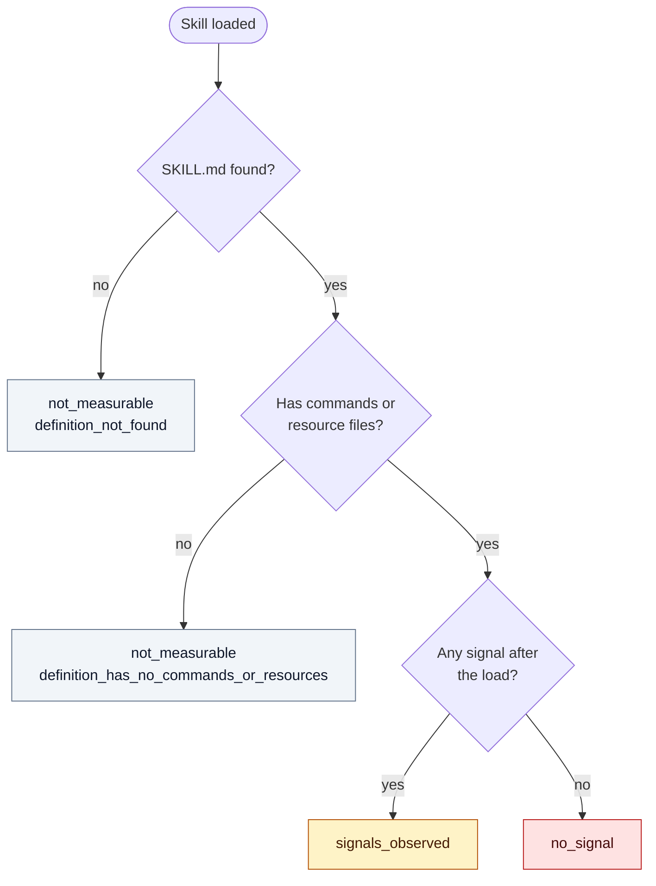
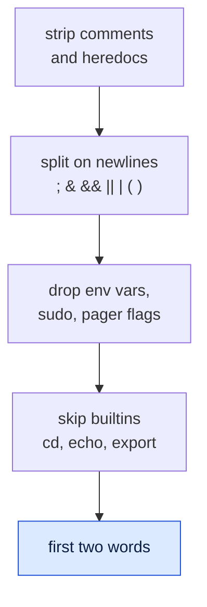
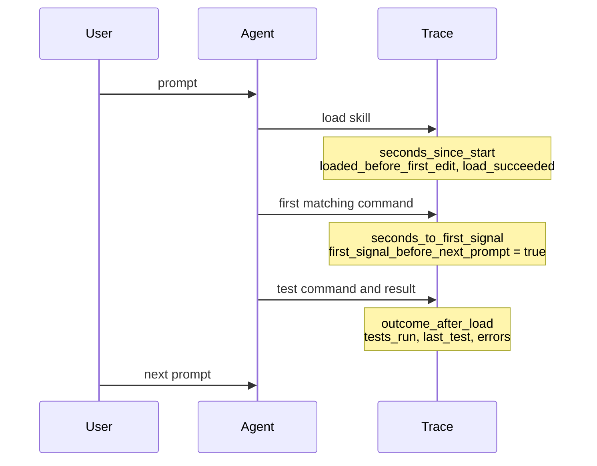
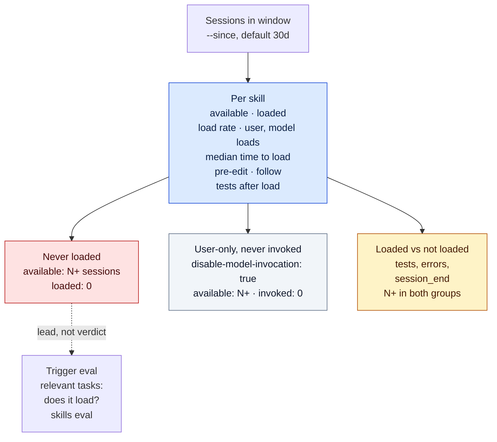

# Skill adoption: `agent-strace skills`

Find out which of your agent skills never load. For each skill, the report
shows whether it was available, loaded, and followed, and what happened after
the load. There is no score, grade, or verdict: facts are counts (`count/n`)
and inferences are labelled *signals*.

## Quick start

**Claude Code, no setup.** Read the transcripts Claude Code already keeps:

```bash
uvx agent-strace skills --from-claude              # last 30 days
uvx agent-strace skills --from-claude --since 90d  # wider window
```

This imports `~/.claude/projects/*/*.jsonl` (or `$CLAUDE_CONFIG_DIR/projects`,
or `--claude-dir DIR`) and prints the report. It writes no persistent trace
store; it uses a temporary directory deleted on exit. Imported events are
redacted the same way as `import` and hook capture. Claude Code
deletes transcripts after 30 days by default (`cleanupPeriodDays`), so the
history may be short.

The first lines say how many transcripts were read and how many sessions the
report covers, with the reason for any gap:

```text
Read 7 Claude Code session(s) from ~/.claude/projects. No persistent trace store was written; the temporary directory is deleted on exit.
Skills across 2 of 7 sessions since 2026-10-16 (5 started before the window). Availability reflects the filesystem now, not session time.
```

Sessions are left out when they started before the `--since` window or are
unreadable or malformed. With `--from-claude`, `--from-copilot` and
`--from-codex`, sessions that [`skills eval`](skills-eval.md) ran in its
temporary workspaces (`agent-strace-skills-eval-<case>-<random>/workspace`) are
left out too: their prompts are written to trigger skills, and the skill copies
they load are deleted afterwards. A stderr line gives the count. Transcripts
that share a session ID are merged into one session, and the `Read` line says
so. Widen the window with `--since 90d`.

**GitHub Copilot and Codex, no setup.** Read the session logs these agents
already keep:

```bash
uvx agent-strace skills --from-copilot   # Copilot CLI and the Copilot app
uvx agent-strace skills --from-codex     # Codex CLI, IDE extension and app
```

| Flag | Reads | Directory |
|---|---|---|
| `--from-copilot` | `session-state/*/events.jsonl` | `--copilot-dir`, else `$COPILOT_HOME`, else `~/.copilot` |
| `--from-codex` | `sessions/**/rollout-*.jsonl` and `archived_sessions/**/rollout-*.jsonl` | `--codex-dir`, else `$CODEX_HOME`, else `~/.codex` |

Both work like `--from-claude`: a temporary store deleted on exit, the same
report, the same redaction. Only what the report needs is imported: tool names,
file paths, commands (for follow signals), result status and exit codes, and
from each prompt only a leading `/name` and any `$name`. Prompt text, model
output and reasoning are never read into the store.

These sessions record which skills the agent was offered, so availability is
the list each session recorded, not today's filesystem. A session that recorded
no list (for example, no skills were installed then) falls back to skill
directories on disk now. The first line says how many sessions did each:

```text
Read 506 GitHub Copilot session(s) from ~/.copilot/session-state. 479 recorded their available skills; the rest use skill directories on disk now. No persistent trace store was written; the temporary directory is deleted on exit.
```

What each reader counts:

| | GitHub Copilot | Codex |
|---|---|---|
| Available | `<available_skills>` in the system message | `<skills_instructions>` or `world_state` skills list |
| Model load | `skill` tool call, or a `skill.invoked` event | read of a listed `SKILL.md` (Codex has no load event) |
| User load | typed prompt starts `/name` or mentions `$name` | prompt mentions `$name`, or a `<skill>` block injected for the user |
| Skipped | session directories with no `events.jsonl` | files whose first record is not `session_meta`; approval review threads |

- Copilot lists skills by name only. A skill's path comes from a
  `skill.invoked` event in any session, when that name always had the same
  path. Otherwise the definition is looked up by name in the skill directories,
  and a skill found nowhere is reported with `definition_found: false`.
- Skill directories that recorded `skill.invoked` paths point to, such as the
  Copilot app's skills or a plugin's, are scanned like `--skills-dir`, if they
  still exist. Project skills are left out. Copilot CLI keeps builtin skills in
  a versioned package directory and deletes old versions when it upgrades, so
  a recorded builtin path that is gone resolves to the newest installed
  version that has the skill.
- Copilot `user.message` events with a `source` of `skill-<name>`, `system`,
  `autopilot` or `agent-<id>` are not prompts: they are injected skill bodies,
  runtime continuations, and messages from another session. Only typed prompts
  count as user loads.
- Codex archived sessions are included, because the report is about history.
  Approval review threads (`thread_source: guardian_review`) are excluded:
  they are reviewer runs, not user sessions.
- Definitions (commands, resources, invocation settings) are always read from
  `SKILL.md` on disk now. Add plugin or app-bundled directories with
  `--skills-dir`.

> [!NOTE]
> Both log formats are internal to the agents and undocumented. They can
> change in any release. The readers skip unknown events, missing fields and a
> truncated last line, and count unreadable files in the `Read` line.

**Any supported agent.** Record sessions, then report:

```bash
uv tool install agent-strace       # hooks need agent-strace on PATH
agent-strace setup --cli copilot   # or claude, codex, gemini, cursor
# use the agent as usual for a few sessions, then, in the same repository:
agent-strace skills
agent-strace skills <session-id>   # one session in detail
```

Copilot CLI users can install the [plugin](copilot-plugin.md) instead of
running `setup`. Sessions go to `.agent-traces/` in the repository you opened,
so run `agent-strace skills` there, or point `--trace-dir` or
`$AGENT_TRACE_DIR` at the store. With no sessions recorded, the command prints
these setup steps instead of an empty report.

The never-loaded list needs a skill to be available in at least
`--min-sessions` sessions (default 5). Lower it for a small store:
`agent-strace skills --min-sessions 2`.

**Next step.** A never-loaded skill is a lead. To check whether it loads when a
task needs it, run [`agent-strace skills eval`](skills-eval.md).

### Supported agents

| Agent | Source | Model load seen as |
|---|---|---|
| Claude Code | `--from-claude` (existing transcripts) or `setup --cli claude` | `Skill` tool call |
| GitHub Copilot CLI and app | `--from-copilot` (existing logs), `setup --cli copilot`, or the plugin | `skill` tool call |
| Gemini CLI | `setup --cli gemini` | `activate_skill` tool call |
| OpenAI Codex | `--from-codex` (existing logs) or `setup --cli codex` | read of a `SKILL.md` |
| Cursor | `setup --cli cursor` | read of a `SKILL.md` |

For every agent, a recorded prompt that starts with `/name` or mentions
`$name` counts as a user load.

Other agents traced through the MCP proxy or the Python decorator count when
they read a `SKILL.md` or call one of the tools above. What each hook records
differs by agent: see the [capture matrix](capture-matrix.md).

`--from-claude` reads top-level session transcripts only. Subagent transcripts
are not read. A transcript's first recorded `cwd` is used as the session's
repository for skill discovery.

### What it cannot tell you

- Whether a task needed the skill. "Never loaded" can mean "never relevant".
- What skills existed when an old session ran, except with `--from-copilot`
  and `--from-codex`, which read the list each session recorded. Otherwise
  availability is read from today's filesystem.
- Whether the skill caused any outcome.

The full list is under [Limits](#limits).

## How the report works



Blue is observed. Amber is consistent with the skill, not caused by it. Model
"thinking" is never used: it is often summarized or omitted, and not reliably
faithful to what the model did.

```bash
agent-strace skills                                  # aggregate, last 30 days
agent-strace skills <session-id>                     # one session
agent-strace skills --skills-dir ~/plugin/skills --format json
```

Flags: [commands.md](commands.md#skills).

## 1. Available



- A `SKILL.md` directly in a directory also counts. Deeper nesting is not
  scanned. The name is frontmatter `name:`, else the directory name.
- The session cwd is `session_start.data.cwd`, else `--workspace`, else the
  current directory. Every directory applies to every session and provider.
- The Codex user directory is `$CODEX_HOME/skills` when `CODEX_HOME` is set
  and non-empty, else `~/.codex/skills`. As in Codex, `~` in the value is not
  expanded, and a relative value resolves against the current directory. The
  value comes from this command's environment, so run it with the
  `CODEX_HOME` that Codex sees. Reports show the resolved directory.
- **Availability is read from today's filesystem.** Older sessions see skills
  added later. Narrow `--since` to reduce this. `--from-copilot` and
  `--from-codex` use the list each session recorded instead (see
  [Quick start](#quick-start)); JSON `availability_basis` is `recorded`, or
  `mixed` when some sessions recorded none, with per-basis counts in
  `availability_basis_sessions`.

### Who can invoke a skill

Two `SKILL.md` frontmatter keys control who can invoke a skill:

| Key | Meaning | Default |
|---|---|---|
| `disable-model-invocation: true` | Only the user can invoke it (`/name`). The model cannot load it | `false` |
| `user-invocable: false` | Only the model can invoke it. It is hidden from the `/` menu | `true` |

Sources: Claude Code,
[Control who invokes a skill](https://code.claude.com/docs/en/skills#control-who-invokes-a-skill);
GitHub Copilot CLI,
[skill frontmatter fields](https://docs.github.com/en/copilot/reference/cli-command-reference#skill-frontmatter-fields).
The [Agent Skills specification](https://agentskills.io/specification) defines
neither key.

- Only top-level frontmatter keys count. The value must be `true` or `false`,
  in any case, optionally quoted. Any other value (`yes`, `on`, `1`, …) keeps
  the default.
- Client settings that override these keys are not read.
- JSON: `model_invocable` and `user_invocable` on each `available` and
  `loaded` entry. They are `null` on a load whose definition was not found.
- Text: the Available list labels a skill `user-only`, `model-only`, or
  `not invocable`.

### Alias and forwarder hints

A hint marks a skill that the model may skip in favour of another discovered
skill. Hints are text pattern matches, not scores or judgements. There are two
kinds:

| Kind | Matches |
|---|---|
| `description_alias` | The description **starts** with an alias phrase followed by another skill's exact name: `Shorthand for finder.`, `Alias of /finder.`, `This skill is the same as finder.` |
| `forwarder` | The body has 1 to 3 lines and at most 40 words after headings, blank lines, rules, and HTML comments are dropped. Every line names the same one other skill: `` Invoke the `interview` skill. ``, `Use /interview.` |

Alias phrases are `shorthand`, `short-hand`, `short form`, `shortcut`,
`alias`, `abbreviation` or `synonym`, followed by `for`, `of` or `to`; or
`same as`. Each may be preceded by `This skill is`, `This is`, `It is` or `Is`,
and by `a`, `an` or `the`. Matching is case-insensitive.

A forwarder line names a skill as a backtick span (`` `interview` ``,
`` `/interview` ``, `` `$interview` ``), a quoted name, `/interview`,
`$interview`, `interview skill`, or `Skill(interview)`.

To avoid false positives:

- A name must match a discovered skill exactly, including case, and must not
  continue into a longer word (`finder` does not match `finders`,
  `finder-v2`, or `finder.md`).
- A skill never hints at itself. When names overlap, the longest wins.
- A body with a code fence, more than 3 lines, more than 40 words, or lines
  that name different skills (or none) is not a forwarder.
- An alias phrase later in the description does not count.

Each hint has `kind`, `target`, and `target_loaded`: whether the target was
loaded in this session (session mode) or in any session in the window
(aggregate mode). Hints appear in JSON on `available` entries, aggregate
`skills` entries, and `never_loaded` and `user_only_not_invoked` entries. Text
output prints them under the skill, for example:

```text
  f (available in 5 sessions)
    hint (description_alias): description says it is an alias of finder; finder was not loaded in the window
```

Context files (`AGENTS.md`, `CLAUDE.md`, `GEMINI.md`,
`.github/copilot-instructions.md`) are reported as present or absent with
`load_observable: false`. Agents inject them without a trace event.

## 2. Loaded



Indigo is invoked by the model. Green is invoked by the user.

- Tool arguments: `skill` (Copilot, Claude Code), `command` (older Claude
  Code), `name` (Gemini). `plugin:name` is accepted. Arguments come from
  `arguments` or `tool_input`, and serialized strings are parsed.
- A `SKILL.md` read is a read tool, a `file_read` event, or a shell reader
  (`cat`, `head`, `sed -n`, …). Editing `SKILL.md` is not a load.
- When the session recorded its skill list (`--from-copilot`, `--from-codex`),
  only a read of a listed skill's `SKILL.md` is a load. Reading another
  `SKILL.md`, for example while editing skills in a repo, is not.
- A path the reader cannot resolve, such as `$d/SKILL.md` in a shell loop, is
  not a load.
- Prompt loads match only available skill names, so `/tmp` or `$HOME` is not
  a load. Claude Code transcripts store `/name` as
  `<command-name>/name</command-name>`, which counts the same way.
- Each load records its event id, seconds since start, whether it came before
  the first edit, and whether it succeeded (only when a linked `tool_result` or
  `error` exists).
- A load with no definition on disk is still a load, with
  `definition_found: false`. Add its directory with `--skills-dir`.

## 3. Followed



| Signal | Seen after the load | Strength |
|---|---|---|
| `resource_read` | A file in the skill directory, other than `SKILL.md`, is read by a read tool or a reader command (`cat`, `grep`, `jq`, …) | Strong |
| `script_run` | A file in the skill directory is executed, directly or through `bash`, `python`, `node`, … | Strong |
| `command_match` | A command's signature matches one from the skill's fenced `bash`, `sh`, `shell`, `zsh`, `console`, `shell-session` or `text` blocks | Weak for generic commands such as `gh api` or `go test` |

The report never says "violated" or "ignored".

A **signature** is the first two words of each simple command. For example:

```text
cd repo && GH_PAGER= gh api repos/o/r/stacks   # list
sudo git --no-pager fetch origin | tail -1
```

gives `gh api`, `git fetch` and `tail -1`:



Relative paths resolve against the session cwd and any earlier `cd` in the same
command line. A bare file name counts only if the skill directory contains it.

## 4. Timing and outcome



Outcome facts sit next to the load. They do not mean the skill caused them.

- `tests_run` uses the [session review projection](session-review-projection.md)
  test classifier.
- `last_test` shows the linked result's `exit_code` and `success` when they
  were recorded. `runner_summary` maps each test runner to `passed` or
  `failed` when the result holds that runner's final summary, read by the
  same strict rules as [review Validation](review.md#findings). The text
  output prints it as `unittest summary passed`. No other result text is
  parsed or printed.
- `errors` counts error events and failed tool results (`success: false`,
  `is_error: true`, or a non-zero exit code). Hooks record a failed tool call
  as an error event; transcripts record it as a failed result, so both count.
- `session_end_recorded` is also reported.

## Aggregate mode



N is `--min-sessions` (default 5). A never-loaded skill is a lead: test it with
[`agent-strace skills eval`](skills-eval.md), which runs tasks that should and
should not load it.

| Field | Denominator (n) |
|---|---|
| `load_rate` | Sessions where the skill was available |
| `loaded_before_first_edit` | Loaded sessions that had an edit |
| `follow_signals`, `follow_signal_kinds` | Loaded sessions with a measurable definition |
| `tests_after_load` | Loaded sessions |

**Never loaded** lists skills that the model can invoke, were available in N or
more sessions, and were loaded in none. It has four caveats. They appear in JSON
as `caveats.never_loaded` and as one line in the text output:

- **Availability is not relevance.** No task in the window may have needed the
  skill.
- **Availability reflects today's filesystem.** Sessions from before a skill
  was installed are over-counted. With a recorded list, this caveat names the
  sessions that recorded none instead.
- **User-only skills are listed separately.** See below.
- **Hints are pattern matches.** A skill with an alias or forwarder hint may
  be unloaded because the model loads its target instead.

**User-only, never invoked** (`user_only_not_invoked` in JSON) lists skills
with `disable-model-invocation: true` that were available in N or more sessions
and invoked in none. The model cannot load them, so they are not trigger
misses. Each entry has `name`, `sessions_available`, `user_invocable`, and
`hints`. The text section is printed only when it is not empty, and notes
skills that also set `user-invocable: false`, which nobody can invoke.

In aggregate mode a skill's `model_invocable` and `user_invocable` are `true`
if any session's definition allows it, `false` if every found definition
forbids it, and `null` if no definition was found. A skill counts as user-only
only when every found definition sets `disable-model-invocation: true`. Every
other count is unchanged. Hinted skills that are in neither list are printed
under "Other skills with alias or forwarder hints".

**Loaded vs not loaded** is correlational: agents load skills because of the
task, so the groups differ in task mix.

## Limits

This command cannot measure:

- what the skill set looked like when an old session ran, unless the session
  recorded it (`--from-copilot`, `--from-codex`);
- whether a task should have triggered a skill (see
  [skills eval](skills-eval.md));
- client settings that change who can invoke a skill;
- whether two skills overlap in meaning, beyond the explicit alias and
  forwarder text above;
- whether auto-injected context files were used;
- skills injected without a tool call, file read, or prompt mention;
- whether non-command guidance (tone, ordering, "prefer X over Y") was followed;
- model reasoning; or
- whether a skill caused an outcome.

Malformed events and unreadable sessions are skipped and counted in
`events_skipped_malformed` and `sessions_skipped_unreadable`. In aggregate
mode, `sessions_total` counts sessions in the store and `sessions_excluded`
counts those left out, by reason: `before_window` and `unreadable`, plus
`skills_eval` with `--from-claude`, `--from-copilot` and `--from-codex`.

**Older stores:** stores captured before the subagent capture fix can hold
many Copilot CLI subagent sessions with `events.ndjson` but no `meta.json`.
This command skips those sessions, so skill loads inside subagents are not
counted. Run `agent-strace backfill-meta` to preview, then
`agent-strace backfill-meta --apply` to write their metadata. See
[`backfill-meta`](commands.md#backfill-meta).

**Why there is no score:** a composite score hides these limits. A score that
favours fewer tool calls or lower cost ranks a session that skipped its tests
above one that ran them.

**Privacy:** the report never prints `SKILL.md` bodies, prompt text, command
text, or absolute skill paths. It prints skill names, scanned directories
(`~`-relative under your home), two-word signatures, skill-relative paths,
event ids, and counts.
