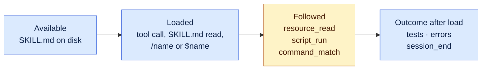
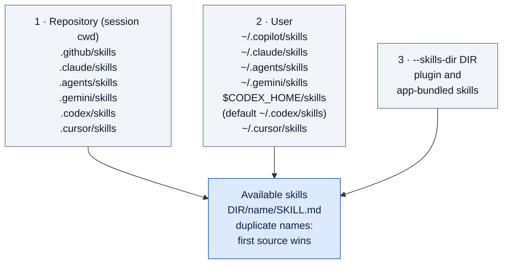
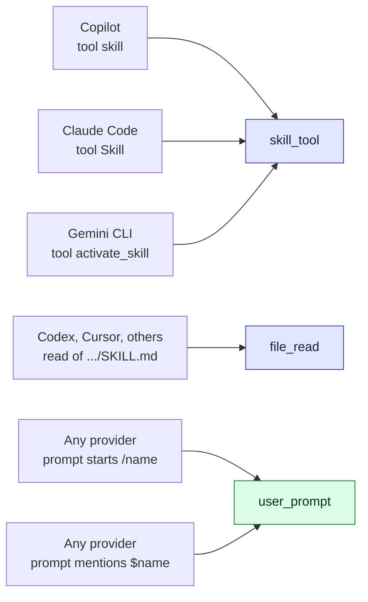
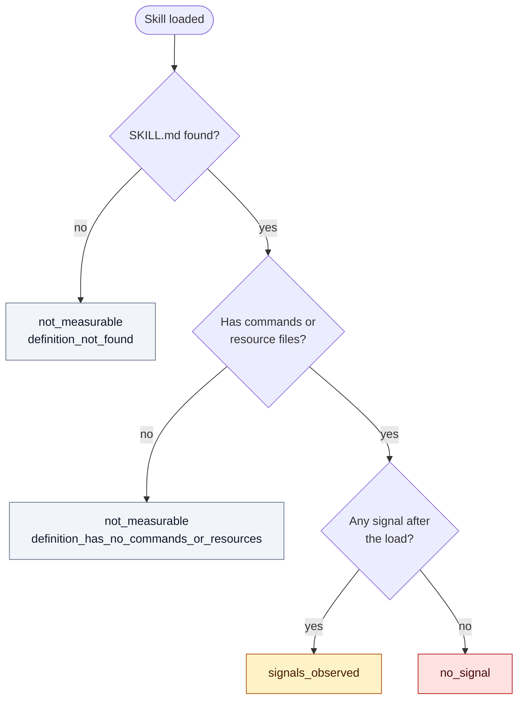
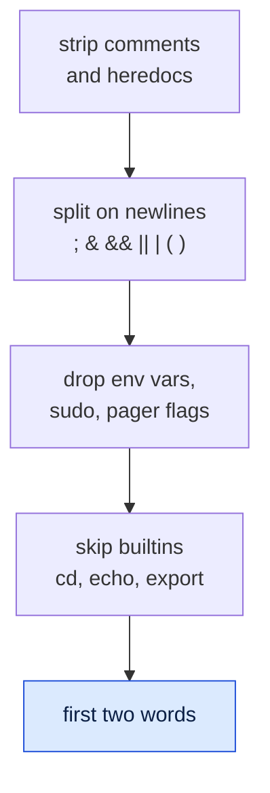
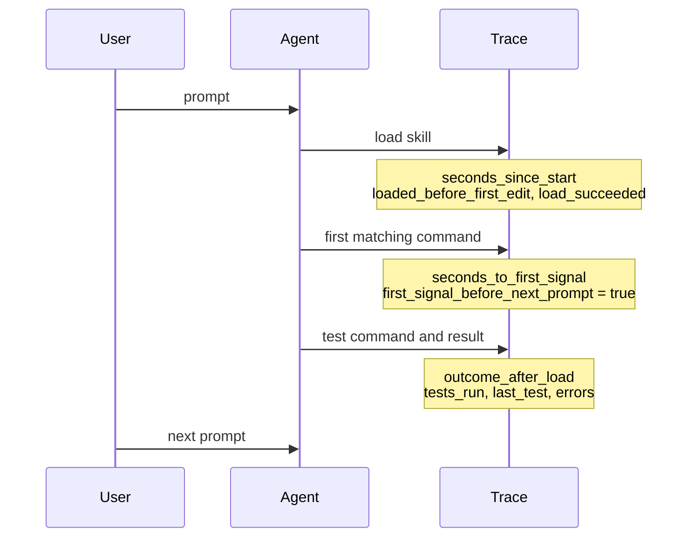
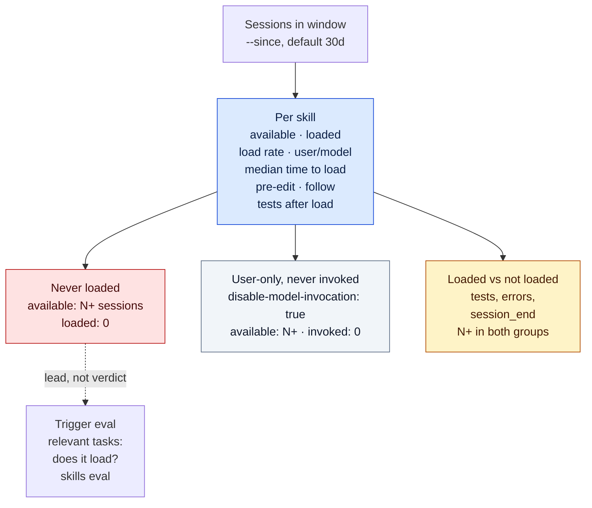

# Skill adoption: `agent-strace skills`

What the trace shows about each skill, in four steps. There is no score, grade,
or verdict: facts are counts (`count/n`) and inferences are labelled *signals*.



Blue is observed. Amber is consistent with the skill, not caused by it. Model
"thinking" is never used: it is often summarized or omitted, and not reliably
faithful to what the model did.

```bash
agent-strace skills                                  # aggregate, last 30 days
agent-strace skills <session-id>                     # one session
agent-strace skills --skills-dir ~/plugin/skills --format json
```

Flags: [commands.md](commands.md#skills).

## 1. Available



- A `SKILL.md` directly in a directory also counts. Deeper nesting is not
  scanned. The name is frontmatter `name:`, else the directory name.
- The session cwd is `session_start.data.cwd`, else `--workspace`, else the
  current directory. Every directory applies to every session and provider.
- The Codex user directory is `$CODEX_HOME/skills` when `CODEX_HOME` is set
  and non-empty, else `~/.codex/skills`. As in Codex, `~` in the value is not
  expanded, and a relative value resolves against the current directory. The
  value comes from this command's environment, so run it with the
  `CODEX_HOME` that Codex sees. Reports show the resolved directory.
- **Availability is read from today's filesystem.** Older sessions see skills
  added later. Narrow `--since` to reduce this.

### Who can invoke a skill

Two `SKILL.md` frontmatter keys control who can invoke a skill:

| Key | Meaning | Default |
|---|---|---|
| `disable-model-invocation: true` | Only the user can invoke it (`/name`). The model cannot load it | `false` |
| `user-invocable: false` | Only the model can invoke it. It is hidden from the `/` menu | `true` |

Sources: Claude Code,
[Control who invokes a skill](https://code.claude.com/docs/en/skills#control-who-invokes-a-skill);
GitHub Copilot CLI,
[skill frontmatter fields](https://docs.github.com/en/copilot/reference/cli-command-reference#skill-frontmatter-fields).
The [Agent Skills specification](https://agentskills.io/specification) defines
neither key.

- Only top-level frontmatter keys count. The value must be `true` or `false`,
  in any case, optionally quoted. Any other value (`yes`, `on`, `1`, …) keeps
  the default.
- Client settings that override these keys are not read.
- JSON: `model_invocable` and `user_invocable` on each `available` and
  `loaded` entry. They are `null` on a load whose definition was not found.
- Text: the Available list labels a skill `user-only`, `model-only`, or
  `not invocable`.

### Alias and forwarder hints

A hint marks a skill that the model may skip in favour of another discovered
skill. Hints are text pattern matches, not scores or judgements. There are two
kinds:

| Kind | Matches |
|---|---|
| `description_alias` | The description **starts** with an alias phrase followed by another skill's exact name: `Shorthand for finder.`, `Alias of /finder.`, `This skill is the same as finder.` |
| `forwarder` | The body has 1 to 3 lines and at most 40 words after headings, blank lines, rules, and HTML comments are dropped. Every line names the same one other skill: `` Invoke the `interview` skill. ``, `Use /interview.` |

Alias phrases are `shorthand`, `short-hand`, `short form`, `shortcut`,
`alias`, `abbreviation` or `synonym`, followed by `for`, `of` or `to`; or
`same as`. Each may be preceded by `This skill is`, `This is`, `It is` or `Is`,
and by `a`, `an` or `the`. Matching is case-insensitive.

A forwarder line names a skill as a backtick span (`` `interview` ``,
`` `/interview` ``, `` `$interview` ``), a quoted name, `/interview`,
`$interview`, `interview skill`, or `Skill(interview)`.

To avoid false positives:

- A name must match a discovered skill exactly, including case, and must not
  continue into a longer word (`finder` does not match `finders`,
  `finder-v2`, or `finder.md`).
- A skill never hints at itself. When names overlap, the longest wins.
- A body with a code fence, more than 3 lines, more than 40 words, or lines
  that name different skills (or none) is not a forwarder.
- An alias phrase later in the description does not count.

Each hint has `kind`, `target`, and `target_loaded`: whether the target was
loaded in this session (session mode) or in any session in the window
(aggregate mode). Hints appear in JSON on `available` entries, aggregate
`skills` entries, and `never_loaded` and `user_only_not_invoked` entries. Text
output prints them under the skill, for example:

```text
  f (available in 5 sessions)
    hint (description_alias): description says it is an alias of finder; finder was not loaded in the window
```

Context files (`AGENTS.md`, `CLAUDE.md`, `GEMINI.md`,
`.github/copilot-instructions.md`) are reported as present or absent with
`load_observable: false`. Agents inject them without a trace event.

## 2. Loaded



Indigo is invoked by the model. Green is invoked by the user.

- Tool arguments: `skill` (Copilot, Claude Code), `command` (older Claude
  Code), `name` (Gemini). `plugin:name` is accepted. Arguments come from
  `arguments` or `tool_input`, and serialized strings are parsed.
- A `SKILL.md` read is a read tool, a `file_read` event, or a shell reader
  (`cat`, `head`, `sed -n`, …). Editing `SKILL.md` is not a load.
- Prompt loads match only available skill names, so `/tmp` or `$HOME` is not
  a load.
- Each load records its event id, seconds since start, whether it came before
  the first edit, and whether it succeeded (only when a linked `tool_result` or
  `error` exists).
- A load with no definition on disk is still a load, with
  `definition_found: false`. Add its directory with `--skills-dir`.

## 3. Followed



| Signal | Seen after the load | Strength |
|---|---|---|
| `resource_read` | A file in the skill directory, other than `SKILL.md`, is read by a read tool or a reader command (`cat`, `grep`, `jq`, …) | Strong |
| `script_run` | A file in the skill directory is executed, directly or through `bash`, `python`, `node`, … | Strong |
| `command_match` | A command's signature matches one from the skill's fenced `bash`, `sh`, `shell`, `zsh`, `console`, `shell-session` or `text` blocks | Weak for generic commands such as `gh api` or `go test` |

The report never says "violated" or "ignored".

A **signature** is the first two words of each simple command. For example:

```text
cd repo && GH_PAGER= gh api repos/o/r/stacks   # list
sudo git --no-pager fetch origin | tail -1
```

gives `gh api`, `git fetch` and `tail -1`:



Relative paths resolve against the session cwd and any earlier `cd` in the same
command line. A bare file name counts only if the skill directory contains it.

## 4. Timing and outcome



Outcome facts sit next to the load. They do not mean the skill caused them.

- `tests_run` uses the [session review projection](session-review-projection.md)
  test classifier.
- `last_test` shows the linked result's `exit_code` and `success` when they
  were recorded. Result text is not parsed.
- `errors` and `session_end_recorded` are also reported.

## Aggregate mode



N is `--min-sessions` (default 5). A never-loaded skill is a lead: test it with
[`agent-strace skills eval`](skills-eval.md), which runs tasks that should and
should not load it.

| Field | Denominator (n) |
|---|---|
| `load_rate` | Sessions where the skill was available |
| `loaded_before_first_edit` | Loaded sessions that had an edit |
| `follow_signals`, `follow_signal_kinds` | Loaded sessions with a measurable definition |
| `tests_after_load` | Loaded sessions |

**Never loaded** lists skills that the model can invoke, were available in N or
more sessions, and were loaded in none. It has four caveats. They appear in JSON
as `caveats.never_loaded` and as one line in the text output:

- **Availability is not relevance.** No task in the window may have needed the
  skill.
- **Availability reflects today's filesystem.** Sessions from before a skill
  was installed are over-counted.
- **User-only skills are listed separately.** See below.
- **Hints are pattern matches.** A skill with an alias or forwarder hint may
  be unloaded because the model loads its target instead.

**User-only, never invoked** (`user_only_not_invoked` in JSON) lists skills
with `disable-model-invocation: true` that were available in N or more sessions
and invoked in none. The model cannot load them, so they are not trigger
misses. Each entry has `name`, `sessions_available`, `user_invocable`, and
`hints`. The text section is printed only when it is not empty, and notes
skills that also set `user-invocable: false`, which nobody can invoke.

In aggregate mode a skill's `model_invocable` and `user_invocable` are `true`
if any session's definition allows it, `false` if every found definition
forbids it, and `null` if no definition was found. A skill counts as user-only
only when every found definition sets `disable-model-invocation: true`. Every
other count is unchanged. Hinted skills that are in neither list are printed
under "Other skills with alias or forwarder hints".

**Loaded vs not loaded** is correlational: agents load skills because of the
task, so the groups differ in task mix.

## Limits

This command cannot measure:

- what the skill set looked like when an old session ran;
- whether a task should have triggered a skill (see
  [skills eval](skills-eval.md));
- client settings that change who can invoke a skill;
- whether two skills overlap in meaning, beyond the explicit alias and
  forwarder text above;
- whether auto-injected context files were used;
- skills injected without a tool call, file read, or prompt mention;
- whether non-command guidance (tone, ordering, "prefer X over Y") was followed;
- model reasoning; or
- whether a skill caused an outcome.

Malformed events and unreadable sessions are skipped and counted in
`events_skipped_malformed` and `sessions_skipped_unreadable`.

**Older stores:** stores captured before the subagent capture fix can hold
many Copilot CLI subagent sessions with `events.ndjson` but no `meta.json`.
This command skips those sessions, so skill loads inside subagents are not
counted. Run `agent-strace backfill-meta` to preview, then
`agent-strace backfill-meta --apply` to write their metadata. See
[`backfill-meta`](commands.md#backfill-meta).

**Why there is no score:** a composite score hides these limits. A score that
favours fewer tool calls or lower cost ranks a session that skipped its tests
above one that ran them.

**Privacy:** the report never prints `SKILL.md` bodies, prompt text, command
text, or absolute skill paths. It prints skill names, scanned directories
(`~`-relative under your home), two-word signatures, skill-relative paths,
event ids, and counts.
